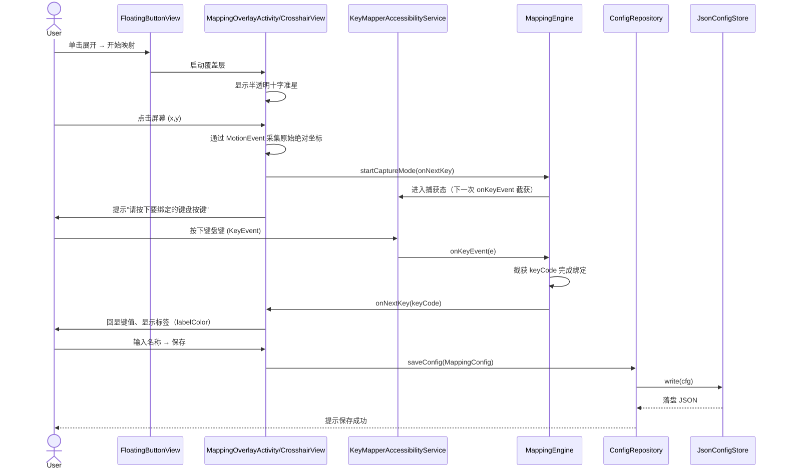
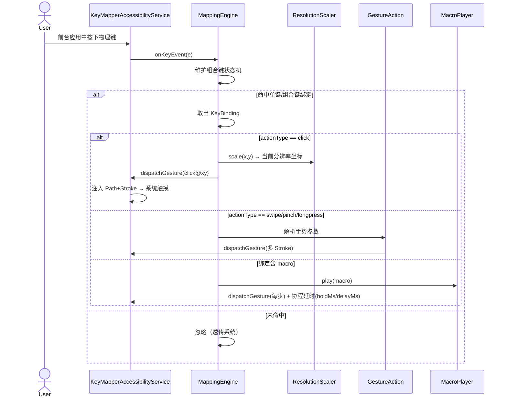
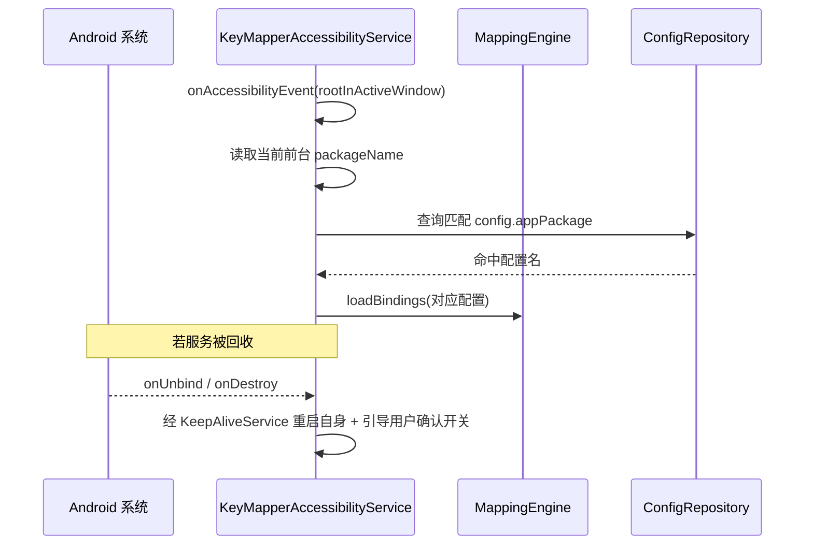
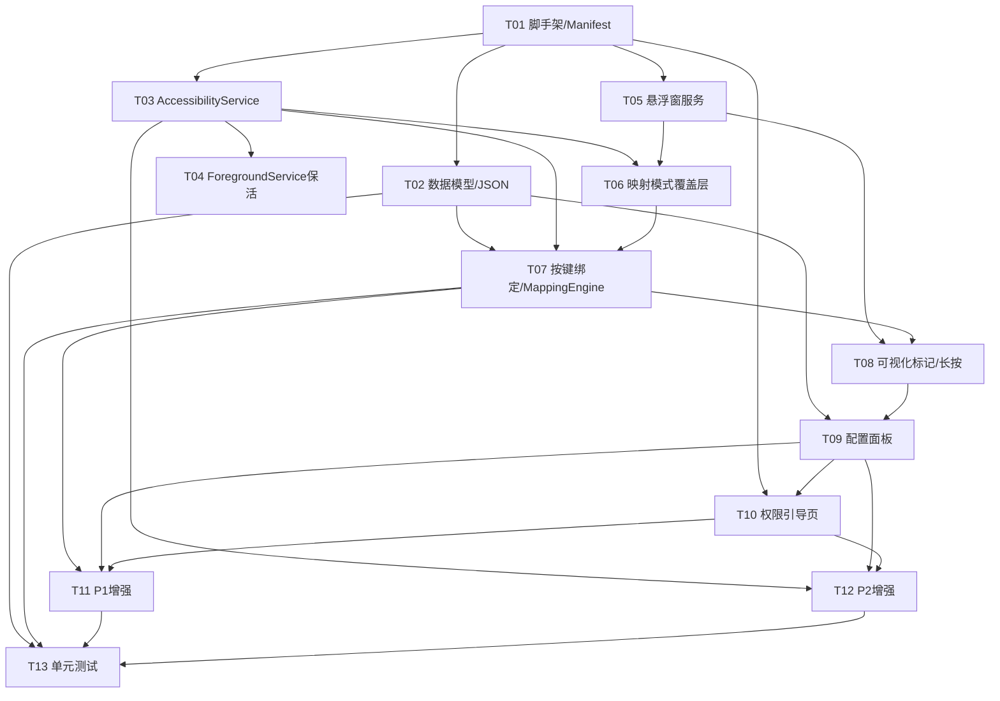

# 自定义屏幕按键映射工具 — 系统架构设计与任务分解

> 文档版本：v1.0 ｜ 角色：架构师（高见远）｜ 项目：`custom_screen_keymapper`
> 平台/语言：Android 原生 · Kotlin · minSdk 24（Android 7.0）｜ 配套 PRD：同目录 `PRD.md`

---

## 一、实现方案 + 框架选型

### 1.1 技术难点分析

| 难点 | 说明 | 解决思路 |
| --- | --- | --- |
| 全局键盘监听 | Android 没有公开 API 让普通应用全局捕获物理键盘事件 | 由 `AccessibilityService.onKeyEvent` 捕获（除 HOME/BACK 等系统保留键外，绝大部分键码可捕获） |
| 屏幕坐标注入（模拟触摸） | 普通应用无法注入触摸事件 | 由 `AccessibilityService.dispatchGesture()` 注入 `GestureDescription`（API 24+ 满足 minSdk） |
| 跨应用常驻显示 | 需要在任意前台应用之上显示悬浮控件 | `WindowManager` + `TYPE_APPLICATION_OVERLAY`（API 23+ 引入，minSdk 24 满足） |
| 服务保活 | 应用在后台被系统回收后需继续监听 | `ForegroundService` + `startForeground` 通知、配合 `AccessibilityService` 自启与 `onUnbind/onDestroy` 重启策略 |
| 坐标分辨率适配 | 不同设备/屏幕密度下坐标需换算 | 映射时以 `MotionEvent` 原始绝对像素为准，保存源分辨率；播放时按目标显示 `getRealSize()` 等比缩放 |

### 1.2 为什么用 Kotlin

- 与 Android 官方工具链（AGP、Compose/ViewBinding）深度集成，`kotlinx.serialization` 原生 JSON 序列化、协程处理 IO/计时器天然契合本项目（配置读写、宏计时回放）。
- 空安全与 `sealed class`/`data class` 让映射数据模型声明式、不可变、易序列化。
- `when` 表达式 + 扩展函数便于把 `KeyEvent` 常量映射为可读标签（如 `Ctrl+1`）。

### 1.3 核心架构模式

采用 **分层 + 单一职责 + 事件总线（轻量广播）**：

```
┌──────────────────────────────────────────────────────────────┐
│  UI 层 (Activity / 悬浮窗 View)                                │
│  MainActivity · MappingOverlayActivity · ConfigPanelActivity  │
│  SettingsActivity · FloatingButtonView · ControlPanelView     │
└───────────────┬──────────────────────────────────────────────┘
                │ (绑定/触发意图、配置读写)
┌───────────────┴──────────────────────────────────────────────┐
│  领域/引擎层                                                    │
│  MappingEngine (按键→动作匹配调度) · MacroPlayer (宏回放)       │
└───────────────┬──────────────────────────────────────────────┘
                │ (模型 + 持久化)
┌───────────────┴──────────────────────────────────────────────┐
│  数据层                                                         │
│  ConfigRepository (用例) · JsonConfigStore (kotlinx.serialization)│
└───────────────┬──────────────────────────────────────────────┘
                │ (系统能力)
┌───────────────┴──────────────────────────────────────────────┐
│  系统服务层                                                     │
│  KeyMapperAccessibilityService (onKeyEvent + dispatchGesture)  │
│  KeepAliveService (ForegroundService 保活)                      │
│  FloatingWindowService (WindowManager 悬浮窗)                   │
└───────────────────────────────────────────────────────────────┘
```

### 1.4 AccessibilityService 双职责（关键设计）

`KeyMapperAccessibilityService` 同时承担：

1. **全局键盘监听**：重写 `onKeyEvent(KeyEvent)`，无论应用在前台还是后台，物理键盘事件都会回调（HOME/BACK/RECENTS 等系统键除外，属可接受范围）。`MappingEngine` 订阅此事件完成"绑定采集"与"触发匹配"。
2. **手势注入**：提供 `dispatchGesture(GestureDescription, callback, handler)`，把映射的点击/长按/滑动/缩放解析成 `Path`+`StrokeDescription` 注入触摸。

> 设计要点：`AccessibilityService` 自身即使被回收，只要无障碍开关打开，系统会在下次需要时重启它；我们在 `onUnbind`/`onDestroy` 中通过 `KeepAliveService` 的定时 `AlarmManager`/广播再次 `startService` + 引导用户确保开关开启，形成保活闭环。

### 1.5 保活方案

- `KeepAliveService` 继承 `Service` 并 `startForeground`（必须展示常驻通知，满足 Android 8+ 前台服务限制）。
- 双重保障：Accessibility 自启 + Foreground 通知（降低被 LMK 杀掉概率）+ `onDestroy` 重启自身。
- 不在本方案引入 `InputMethod`（屏幕键盘）兜底，避免输入法抢占与组合键/宏时序精度受损（见待确认 Q1 决议）。

### 1.6 依赖注入

采用 **Koin**（轻量、无注解处理器、Kotlin 友好），管理 `ConfigRepository`、`JsonConfigStore`、`MappingEngine`、`MacroPlayer`、`ResolutionScaler` 等单例。相比 Hilt 更省构建开销，适合本项目规模。

---

## 二、文件列表及相对路径

> 根目录：`KeyMapper/`。包名统一为 `com.keymapper`。每个文件标注对应需求编号（P0/P1/P2）。

### 2.1 Gradle / 工程配置

| 路径 | 说明 | 需求 |
| --- | --- | --- |
| `settings.gradle.kts` | 工程配置、module 声明 | - |
| `build.gradle.kts` | 顶层依赖与插件（agp、kotlin） | - |
| `gradle.properties` | `android.useAndroidX=true` 等 | - |
| `app/build.gradle.kts` | app module：minSdk24/targetSdk34、依赖、kotlinx-serialization 插件 | - |
| `app/proguard-rules.pro` | 混淆规则（保留序列化模型） | - |

### 2.2 清单与系统配置

| 路径 | 说明 | 需求 |
| --- | --- | --- |
| `app/src/main/AndroidManifest.xml` | 声明 AccessibilityService、ForegroundService、SYSTEM_ALERT_WINDOW 权限 | P0-1/P0-6/P0-8 |
| `app/src/main/res/xml/accessibility_service_config.xml` | 无障碍服务配置（flags 含 `canRetrieveWindowContent`、`requestFilterKeyEvents`，capabilities） | P0-6 |
| `app/src/main/res/xml/keep_alive_service_config.xml` | （可选）前台服务类型声明 `foregroundServiceType` | P0-6 |

### 2.3 Application / 入口

| 路径 | 说明 | 需求 |
| --- | --- | --- |
| `app/src/main/java/com/keymapper/MainApplication.kt` | `Application`，初始化 Koin、默认配置目录 | - |
| `app/src/main/java/com/keymapper/MainActivity.kt` | 入口 Activity：检查权限→跳设置或启动悬浮窗 | P0-1/P0-8 |
| `app/src/main/java/com/keymapper/di/AppModule.kt` | Koin 模块声明 | - |

### 2.4 领域模型（domain/model）

| 路径 | 说明 | 需求 |
| --- | --- | --- |
| `app/src/main/java/com/keymapper/domain/model/MappingConfig.kt` | 配置根：`configName/screenWidth/screenHeight/bindings[]/createdAt` | P0-5/P0-7/P1-4 |
| `app/src/main/java/com/keymapper/domain/model/KeyBinding.kt` | 单条绑定：`x/y/keyCode/keyCombination?/labelColor/actionType/gestureParams?/macro?` | P0-3/P0-4/P1-2/P2-1 |
| `app/src/main/java/com/keymapper/domain/model/GestureAction.kt` | 手势参数：`type(click/longpress/swipe/pinch)` + 解析字段 | P2-1 |
| `app/src/main/java/com/keymapper/domain/model/Macro.kt` | 宏：`name/steps:List<MacroStep>` | P1-3 |
| `app/src/main/java/com/keymapper/domain/model/MacroStep.kt` | 宏步骤：`action/keyCode?/x?/y?/holdMs?/delayMs?/repeat?` | P1-3/P1-2 |

### 2.5 数据层（data）

| 路径 | 说明 | 需求 |
| --- | --- | --- |
| `app/src/main/java/com/keymapper/data/JsonConfigStore.kt` | 基于 `kotlinx.serialization.json` 的 JSON 读写/导入导出文件 | P0-7/P1-6 |
| `app/src/main/java/com/keymapper/data/ConfigRepository.kt` | 用例封装：save/load/delete/list/import/export，调用 JsonConfigStore | P0-5/P1-1/P1-6 |

### 2.6 系统服务层

| 路径 | 说明 | 需求 |
| --- | --- | --- |
| `app/src/main/java/com/keymapper/accessibility/KeyMapperAccessibilityService.kt` | `onKeyEvent` 全局键盘 + `dispatchGesture` 注入 + `onAccessibilityEvent` 前台包名检测 | P0-6/P1-1/P1-2/P2-2 |
| `app/src/main/java/com/keymapper/service/KeepAliveService.kt` | `ForegroundService` 保活（startForeground 通知 + 重启策略） | P0-6 |
| `app/src/main/java/com/keymapper/service/FloatingWindowService.kt` | `WindowManager` 挂载悬浮窗（按钮+面板+标记层） | P0-1/P0-4 |

### 2.7 引擎层（engine）

| 路径 | 说明 | 需求 |
| --- | --- | --- |
| `app/src/main/java/com/keymapper/engine/MappingEngine.kt` | 按键事件→匹配 `KeyBinding`→调用 AccessibilityService 注入；组合键状态机 | P0-3/P0-6/P1-2 |
| `app/src/main/java/com/keymapper/engine/MacroPlayer.kt` | 宏回放：按 `MacroStep` 时序执行 key/gesture，支持 holdMs/repeat | P1-3 |

### 2.8 UI 层（ui）

| 路径 | 说明 | 需求 |
| --- | --- | --- |
| `app/src/main/java/com/keymapper/ui/mapping/MappingOverlayActivity.kt` | 映射模式全屏半透明覆盖层宿主 | P0-2 |
| `app/src/main/java/com/keymapper/ui/mapping/CrosshairView.kt` | 十字准星 + `MotionEvent` 坐标采集 | P0-2/P0-4/Q4 |
| `app/src/main/java/com/keymapper/ui/config/ConfigPanelActivity.kt` | 配置管理：命名保存/加载/删除/切换 + 导入导出/测试映射入口 | P0-5/P1-1/P1-6/P1-5 |
| `app/src/main/java/com/keymapper/ui/config/ConfigListAdapter.kt` | 配置列表适配器 | P0-5/P1-1 |
| `app/src/main/java/com/keymapper/ui/settings/SettingsActivity.kt` | 设置 + 权限引导（无障碍/悬浮窗/低电量降频开关） | P0-8/P2-3 |
| `app/src/main/java/com/keymapper/ui/floating/FloatingButtonView.kt` | 可拖拽悬浮小球 + 展开/收起 | P0-1 |
| `app/src/main/java/com/keymapper/ui/floating/ControlPanelView.kt` | 展开操作面板（开始映射/加载配置/设置） | P0-1/P1-1 |
| `app/src/main/java/com/keymapper/ui/debug/DebugHighlightView.kt` | 调试模式高亮标记层 | P1-5 |

### 2.9 工具层（util）

| 路径 | 说明 | 需求 |
| --- | --- | --- |
| `app/src/main/java/com/keymapper/util/ResolutionScaler.kt` | 源分辨率→目标分辨率坐标等比缩放 | P1-4 |
| `app/src/main/java/com/keymapper/util/PermissionHelper.kt` | 权限检查/跳转（无障碍、SYSTEM_ALERT_WINDOW） | P0-8 |
| `app/src/main/java/com/keymapper/util/KeyEventUtil.kt` | `KeyEvent` 常量→可读标签（Ctrl+1 等）、组合键格式化 | P1-2 |
| `app/src/main/java/com/keymapper/util/Constants.kt` | 广播 Action 常量、Intent extra key、引擎状态枚举 | 全局 |

### 2.10 资源（res）

| 路径 | 说明 | 需求 |
| --- | --- | --- |
| `app/src/main/res/layout/activity_main.xml` | 入口布局 | - |
| `app/src/main/res/layout/activity_mapping_overlay.xml` | 映射覆盖层布局 | P0-2 |
| `app/src/main/res/layout/floating_button.xml` | 悬浮小球布局 | P0-1 |
| `app/src/main/res/layout/control_panel.xml` | 操作面板布局 | P0-1 |
| `app/src/main/res/layout/activity_config_panel.xml` | 配置面板布局 | P0-5 |
| `app/src/main/res/layout/activity_settings.xml` | 设置/权限引导布局 | P0-8 |
| `app/src/main/res/layout/item_config.xml` | 配置列表项 | P0-5 |
| `app/src/main/res/values/strings.xml` | 文案（含权限说明） | P0-8 |
| `app/src/main/res/values/colors.xml` | 标签默认色板 | P0-4 |
| `app/src/main/res/values/themes.xml` | 主题 | - |
| `app/src/main/res/drawable/*.xml` | 悬浮球图标、十字准星、面板背景等 | P0-1/P0-2 |
| `app/src/main/res/mipmap-*/ic_launcher.png` | 图标 | - |

### 2.11 测试

| 路径 | 说明 | 需求 |
| --- | --- | --- |
| `app/src/test/java/com/keymapper/ResolutionScalerTest.kt` | 分辨率缩放单元测试 | P1-4 |
| `app/src/test/java/com/keymapper/KeyBindingSerializationTest.kt` | JSON 序列化/反序列化与兼容字段 | P0-7 |
| `app/src/test/java/com/keymapper/MappingEngineTest.kt` | 单键/组合键匹配逻辑 | P1-2 |
| `app/src/test/java/com/keymapper/MacroPlayerTest.kt` | 宏步骤时序/holdMs/repeat | P1-3 |
| `app/src/androidTest/java/com/keymapper/ConfigRepositoryInstrumentedTest.kt` | 配置保存/加载/导入导出集成 | P0-5/P1-6 |

**统计**：Kotlin 源文件 **34** 个，XML/资源 **~22** 个，测试 **5** 个；共计约 **61** 个文件（含 Gradle 配置）。

---

## 三、数据结构与接口（类图）

```mermaid
classDiagram
    direction LR

    class MappingConfig {
        +String configName
        +Int screenWidth
        +Int screenHeight
        +List~KeyBinding~ bindings
        +Long createdAt
        +String? appPackage  %% P1-1 自动匹配前台应用
        +toJson() String
        +scaledCopy(targetW, targetH) MappingConfig
    }

    class KeyBinding {
        +Int x
        +Int y
        +Int keyCode
        +List~Int~? keyCombination  %% P1-2 组合键（如 [Ctrl,1]）
        +String labelColor  %% hex 如 #FF5722
        +ActionType actionType  %% click/longpress/swipe/pinch
        +GestureAction? gestureParams  %% P2-1
        +Macro? macro  %% P1-3 / P1-2
        +String? label
        +displayKey() String
    }

    class GestureAction {
        +GestureType type  %% click/longpress/swipe/pinch
        +Long durationMs  %% 长按/总时长
        +Point? from  %% swipe 起点
        +Point? to  %% swipe 终点
        +Float scaleFactor  %% pinch 缩放比
        +Point? focal  %% pinch 焦点
    }

    class Macro {
        +String name
        +List~MacroStep~ steps
        +toJson() String
    }

    class MacroStep {
        +StepAction action  %% key_down/key_up/click/swipe/wait
        +Int? keyCode
        +Int? x
        +Int? y
        +Long holdMs  %% 按住时长
        +Long delayMs  %% 步骤间延时（默认粒度 50ms）
        +Int repeat  %% 重复次数
    }

    class Point {
        +Int x
        +Int y
    }

    class ConfigRepository {
        -JsonConfigStore store
        +saveConfig(cfg) Unit
        +loadConfig(name) MappingConfig?
        +deleteConfig(name) Boolean
        +listConfigs() List~String~
        +exportToFile(cfg, uri) Unit
        +importFromFile(uri) MappingConfig
    }

    class JsonConfigStore {
        -Context ctx
        +read(name) MappingConfig?
        +write(cfg) Unit
        +delete(name) Boolean
        +listNames() List~String~
        +serialize(cfg) String
        +deserialize(json) MappingConfig
    }

    class MappingEngine {
        -Map~Int, KeyBinding~ singleMap
        -Map~List~Int~, KeyBinding~ comboMap
        -KeyMapperAccessibilityService svc
        +loadBindings(cfg) Unit
        +onKeyEvent(e) Unit
        +matchAndDispatch(keyCode) Unit
        +startCaptureMode(onNextKey) Unit
    }

    class MacroPlayer {
        -KeyMapperAccessibilityService svc
        +play(macro) Unit
        -executeStep(step) Unit
    }

    class KeyMapperAccessibilityService {
        +onKeyEvent(KeyEvent) Boolean
        +dispatchGesture(desc, cb, h) Boolean
        +onAccessibilityEvent(event) Unit
    }

    MappingConfig "1" *-- "0..*" KeyBinding : bindings
    KeyBinding "1" o-- "0..1" GestureAction : gestureParams
    KeyBinding "1" o-- "0..1" Macro : macro
    Macro "1" *-- "1..*" MacroStep : steps
    GestureAction "0..1" o-- "1..*" Point : from/to/focal
    MacroPlayer ..> KeyMapperAccessibilityService : dispatchGesture
    MappingEngine ..> KeyMapperAccessibilityService : dispatchGesture
    MappingEngine ..> Macro : play()
    MacroPlayer ..> Macro : execute
    ConfigRepository --> JsonConfigStore : 使用
    JsonConfigStore ..> MappingConfig : 序列化
```



> **JSON 字段约定（P0-7）**：`MappingConfig` 序列化示例
> ```json
> {
>   "configName": "王者荣耀方案",
>   "screenWidth": 1080,
>   "screenHeight": 2400,
>   "appPackage": null,
>   "createdAt": 1718700000000,
>   "bindings": [
>     {
>       "x": 540, "y": 960, "keyCode": 33,
>       "keyCombination": null,
>       "labelColor": "#FF5722",
>       "actionType": "click",
>       "gestureParams": null,
>       "macro": null,
>       "label": "技能1"
>     }
>   ]
> }
> ```
> 预留 `gestureParams/macro/keyCombination/appPackage` 字段保证 P1/P2 向前兼容。

---

## 四、程序调用流程（时序图）

### (a) 映射模式：记录坐标 → 绑定按键 → 保存配置



### (b) 键盘按键触发 → MappingEngine 匹配 → dispatchGesture 注入触摸



### (c)（补充）P1-1 前台应用自动切换 + 保活重启



---

## 五、有序任务列表（按实现顺序，含依赖）

> 每个任务含：ID／标题／需求编号／依赖／产出文件／验收点。

### T01　项目脚手架与 Manifest/权限声明
- **需求**：P0-1/P0-6/P0-8（基建）
- **依赖**：无
- **产出**：`settings.gradle.kts`、`build.gradle.kts`、`gradle.properties`、`app/build.gradle.kts`、`app/proguard-rules.pro`、`AndroidManifest.xml`、`res/xml/accessibility_service_config.xml`、`MainApplication.kt`、`MainActivity.kt`
- **验收**：Gradle 可同步（无需本机编译 APK）；Manifest 正确声明 AccessibilityService、ForegroundService 与 `SYSTEM_ALERT_WINDOW`。

### T02　数据模型与 JSON 存储
- **需求**：P0-5/P0-7/P1-2/P1-3/P1-4/P2-1
- **依赖**：T01
- **产出**：`domain/model/*`(5)、`data/JsonConfigStore.kt`、`data/ConfigRepository.kt`、`util/Constants.kt`、`util/KeyEventUtil.kt`
- **验收**：`MappingConfig` 可序列化为含 `configName/screenWidth/screenHeight/bindings[]/createdAt` 的 JSON；`KeyBinding` 含 `keyCombination?/labelColor/actionType/gestureParams?/macro?`；缺失字段有默认/报错。

### T03　AccessibilityService（键盘监听 + 手势注入）
- **需求**：P0-6/P1-2/P2-2
- **依赖**：T01
- **产出**：`accessibility/KeyMapperAccessibilityService.kt`
- **验收**：`onKeyEvent` 能捕获全局物理键（除系统保留键）；`dispatchGesture` 可按 `GestureDescription` 注入点击；`onAccessibilityEvent` 能读前台包名。

### T04　ForegroundService 保活
- **需求**：P0-6
- **依赖**：T03
- **产出**：`service/KeepAliveService.kt`、`res/xml/keep_alive_service_config.xml`
- **验收**：`startForeground` 显示常驻通知；`onDestroy` 内尝试重启自身；与 AccessibilityService 形成保活闭环。

### T05　悬浮窗服务（拖拽 + 面板）
- **需求**：P0-1
- **依赖**：T01
- **产出**：`service/FloatingWindowService.kt`、`ui/floating/FloatingButtonView.kt`、`ui/floating/ControlPanelView.kt`、`res/layout/floating_button.xml`、`res/layout/control_panel.xml`、`res/drawable/*`
- **验收**：悬浮球可拖拽、跨应用常驻；单击展开面板（开始映射/加载配置/设置）。

### T06　映射模式覆盖层（十字准星 + 坐标采集）
- **需求**：P0-2/P0-4(Q4)
- **依赖**：T03,T05
- **产出**：`ui/mapping/MappingOverlayActivity.kt`、`ui/mapping/CrosshairView.kt`、`res/layout/activity_mapping_overlay.xml`
- **验收**：进入全屏半透明覆盖层并绘制十字准星；点击通过 `MotionEvent` 采集原始绝对坐标；可连续采集。

### T07　按键绑定流程（MappingEngine）
- **需求**：P0-3/P1-2
- **依赖**：T02,T03,T06
- **产出**：`engine/MappingEngine.kt`、`ui/mapping/CrosshairView.kt`(捕获态联动)、`util/KeyEventUtil.kt`(组合键格式化)
- **验收**：记录坐标后捕获下一次按键完成绑定并回显；支持单键与组合键状态机；误触单键不触发组合。

### T08　可视化标记与长按管理
- **需求**：P0-4
- **依赖**：T05,T07
- **产出**：标记层（并入 `FloatingWindowService` 或新增 `ui/floating/MarkerLayerView.kt`）、`util/Constants.kt`
- **验收**：绑定点显示标签与颜色；长按弹出删除/重绑菜单；数据与界面即时同步。

### T09　配置面板（保存/加载/删除/切换）
- **需求**：P0-5/P1-1
- **依赖**：T02,T08
- **产出**：`ui/config/ConfigPanelActivity.kt`、`ui/config/ConfigListAdapter.kt`、`res/layout/activity_config_panel.xml`、`res/layout/item_config.xml`
- **验收**：命名保存当前映射；列表可加载（覆盖）/删除（二次确认）；悬浮窗下拉可一键切换方案。

### T10　权限引导页
- **需求**：P0-8
- **依赖**：T01,T09
- **产出**：`ui/settings/SettingsActivity.kt`、`util/PermissionHelper.kt`、`res/layout/activity_settings.xml`、`res/values/strings.xml`(权限说明)
- **验收**：未授权时启动即提示并跳转对应设置页；逐项引导可查看"为什么需要"；全部就绪后进入正常使用。

### T11　P1 增强（多模式/组合键/宏/分辨率适配/调试高亮/导入导出）
- **需求**：P1-1~P1-6
- **依赖**：T07,T09,T10
- **产出**：`engine/MacroPlayer.kt`、`util/ResolutionScaler.kt`、`ui/debug/DebugHighlightView.kt`、`data/*`(import/export)、`res/layout/activity_config_panel.xml`(测试/导入导出按钮)
- **验收**：宏按 50ms 粒度+holdMs/repeat 回放；加载按当前分辨率等比缩放；测试模式按键高亮；导出/导入 JSON（同名有覆盖/重命名提示）。

### T12　P2 增强（手势扩展/滚轮/低电量降频）
- **需求**：P2-1/P2-2/P2-3
- **依赖**：T03,T09,T10
- **产出**：`domain/model/GestureAction.kt`(充实)、`KeyMapperAccessibilityService.kt`(滚轮 onKeyEvent/AKEYCODE_`...`)、`ui/settings/SettingsActivity.kt`(低电量开关)、电量监听
- **验收**：可映射长按/滑动/双指缩放并区分标识；滚轮上/下→滑上/下滑（无鼠标设备优雅隐藏）；低电量自动降频且不影响触发精度。

### T13　单元测试
- **需求**：P0-7/P1-2/P1-3/P1-4（质量保障）
- **依赖**：T02,T07,T11,T12
- **产出**：`test/ResolutionScalerTest.kt`、`test/KeyBindingSerializationTest.kt`、`test/MappingEngineTest.kt`、`test/MacroPlayerTest.kt`、`androidTest/ConfigRepositoryInstrumentedTest.kt`
- **验收**：缩放公式、JSON 兼容、组合键匹配、宏时序、配置存取均通过测试。

**阶段汇总**：基建 2 项（T01-T02）→ 系统能力 2 项（T03-T04）→ 悬浮/映射/绑定 UI 4 项（T05-T08）→ 配置/权限 2 项（T09-T10）→ P1 增强 1 项（T11）→ P2 增强 1 项（T12）→ 测试 1 项（T13），共 **13** 个任务。

---

## 六、依赖包列表（Gradle dependencies）

`app/build.gradle.kts`（`app/` 级）：

```kotlin
plugins {
    id("com.android.application")
    id("org.jetbrains.kotlin.android")
    id("org.jetbrains.kotlin.plugin.serialization") // kotlinx-serialization
}

android {
    namespace = "com.keymapper"
    compileSdk = 34
    defaultConfig {
        minSdk = 24
        targetSdk = 34
        // ...
    }
    buildFeatures { viewBinding = true }
}

dependencies {
    // Kotlin 与协程
    implementation("org.jetbrains.kotlin:kotlin-stdlib:1.9.22")
    implementation("org.jetbrains.kotlinx:kotlinx-coroutines-android:1.7.3")

    // AndroidX 基础
    implementation("androidx.core:core-ktx:1.12.0")
    implementation("androidx.appcompat:appcompat:1.6.1")
    implementation("androidx.constraintlayout:constraintlayout:2.1.4")
    implementation("com.google.android.material:material:1.11.0")

    // 生命周期（ViewModel/LiveData）
    implementation("androidx.lifecycle:lifecycle-viewmodel-ktx:2.7.0")
    implementation("androidx.lifecycle:lifecycle-livedata-ktx:2.7.0")
    implementation("androidx.lifecycle:lifecycle-runtime-ktx:2.7.0")

    // JSON 序列化（P0-7 核心）
    implementation("org.jetbrains.kotlinx:kotlinx-serialization-json:1.6.2")

    // 轻量依赖注入
    implementation("io.insert-koin:koin-android:3.5.3")

    // 测试
    testImplementation("junit:junit:4.13.2")
    testImplementation("org.jetbrains.kotlinx:kotlinx-coroutines-test:1.7.3")
    androidTestImplementation("androidx.test.ext:junit:1.1.5")
    androidTestImplementation("androidx.test.espresso:espresso-core:3.5.1")
}
```

顶层 `build.gradle.kts` 插件版本约束：
- AGP `com.android.tools.build:gradle:8.2.2`
- Kotlin `org.jetbrains.kotlin:kotlin-gradle-plugin:1.9.22`
- Kotlin Gradle Plugin 与 stdlib 版本须一致。

> 说明：选 `ViewBinding` 而非 Jetpack Compose，理由是悬浮窗/覆盖层大量使用 `WindowManager` 动态挂载，传统 View + XML 更直接、与 AccessibilityService 协作简单；`Material` 仅用于面板基础控件。DI 选 Koin 而非 Hilt，规避注解处理器对纯 Kotlin 模块的开销。

---

## 七、共享知识（跨文件约定）

| 约定 | 内容 |
| --- | --- |
| **坐标单位** | 统一为**屏幕绝对像素（px）**，不混用 dp。保存时记录 `screenWidth/screenHeight`（源分辨率）；播放前经 `ResolutionScaler` 按当前 `Display.getRealSize()` 等比缩放。 |
| **颜色** | 标签颜色一律用 **hex 字符串**（如 `"#FF5722"`），存于 `KeyBinding.labelColor`，默认取 `colors.xml` 色板。 |
| **keyCode** | 主键以 **Android `KeyEvent` 常量**（`android.view.KeyEvent.KEYCODE_*`）的 `Int` 值存储；组合键存 `List<Int>`（如 `[KEYCODE_CTRL_LEFT, KEYCODE_1]`）。`KeyEventUtil` 负责 → 可读标签（`Ctrl+1`）。 |
| **手势类型** | `actionType` 枚举：`click` / `longpress` / `swipe` / `pinch`（P2-1）；扩展只需在 `GestureAction` 增加字段，保持 JSON 向前兼容。 |
| **线程模型** | UI 操作在主线程；JSON 读写、导入导出等 IO 走 **Kotlin 协程（`Dispatchers.IO`）**；宏回放计时用 `Delay`/协程，避免阻塞主线程。 |
| **广播 Action 命名** | 统一前缀 `com.keymapper.action.`，如 `com.keymapper.action.START_MAPPING`、`...SWITCH_CONFIG`、`...TEST_MODE_ON`、`...LOW_BATTERY`。用 `Constants.kt` 集中定义。 |
| **Intent Extra Key** | 统一前缀 `EXTRA_KEYMAPPER_`，如 `EXTRA_KEYMAPPER_CONFIG_NAME`。 |
| **配置目录** | 默认 `Context.getFilesDir()/configs/` 存 JSON；导入导出用 `SAF`（`Intent.ACTION_CREATE_DOCUMENT` / `OPEN_DOCUMENT`）定位外部 URI。 |
| **宏时间粒度** | 默认 **50ms**（`MacroStep.delayMs` 最小单位）；`holdMs` 表示按住时长，`repeat` 表示重复次数。 |
| **分辨率适配权威源** | 采集坐标以覆盖层 `MotionEvent` 的**原始绝对坐标**为准（Q4）；播放以 `WindowManager.getDefaultDisplay().getRealSize()` 为目标，规避导航栏/刘海偏移。 |

---

## 八、待确认事项 — 技术决议（不遗留空白）

> 对 PRD 第五节的 5 项问题，给出明确架构决议（已采纳 team-lead 建议并做必要优化）。

**Q1 全局键盘来源与兜底**
→ 以 **`AccessibilityService.onKeyEvent` 为主**，可捕获绝大多数物理键（HOME/BACK/RECENTS 等系统保留键除外，属可接受范围）；用 **`ForegroundService`（`KeepAliveService`）** 保活，`onUnbind/onDestroy` 经 `AlarmManager`/广播重启自身并引导用户确认无障碍开关开启。**不引入 `InputMethod`**（屏幕键盘）兜底，避免输入法抢占焦点导致组合键/宏时序精度受损。组合键与宏精度依赖 `onKeyEvent` 的事件时序，配合 `MappingEngine` 组合键状态机即可满足。

**Q2 宏最小时间精度**
→ 默认 **50ms** 时间粒度。`MacroStep` 支持 **`holdMs`（按住时长）** 与 **`repeat`（重复次数）** 字段；`delayMs` 表示相邻步骤间隔，回放在协程中按 `(delayMs / holdMs)` 时序调度，保证连招顺序正确。

**Q3 复杂手势触发**
→ 长按/滑动由键盘触发 `dispatchGesture` 模拟；**双指缩放**用"按住某修饰键（如 Shift）+ 方向键/字母"或 **鼠标滚轮**触发；**滚轮上/下 → swipe up/down**（P2-2）。无鼠标设备时滚轮能力在设置中优雅隐藏/禁用。

**Q4 坐标权威来源**
→ 映射模式由覆盖层 **`CrosshairView` 的 `MotionEvent` 采集原始屏幕绝对坐标**（最可靠，规避无障碍节点坐标误差）；播放时用 `dispatchGesture` 注入绝对坐标；读取 `WindowManager.getDefaultDisplay().getRealSize()` 与 `DisplayMetrics` 处理 DPI/刘海，保存时记录源分辨率供 `ResolutionScaler` 缩放。

**Q5 多配置作用域判定**
→ 默认 **手动下拉切换**（悬浮窗面板/下拉菜单）；额外提供 **"按前台应用包名自动匹配"**（在 `AccessibilityService.onAccessibilityEvent` 读 `rootInActiveWindow.packageName`）作为可选项（存于 `MappingConfig.appPackage`），由用户在设置中开启，避免误切换。

---

## 附录：任务依赖图



---
*本文档仅含架构设计与任务分解，不含实现代码。由架构师高见远产出，供工程师实现、QA 编写测试。*
