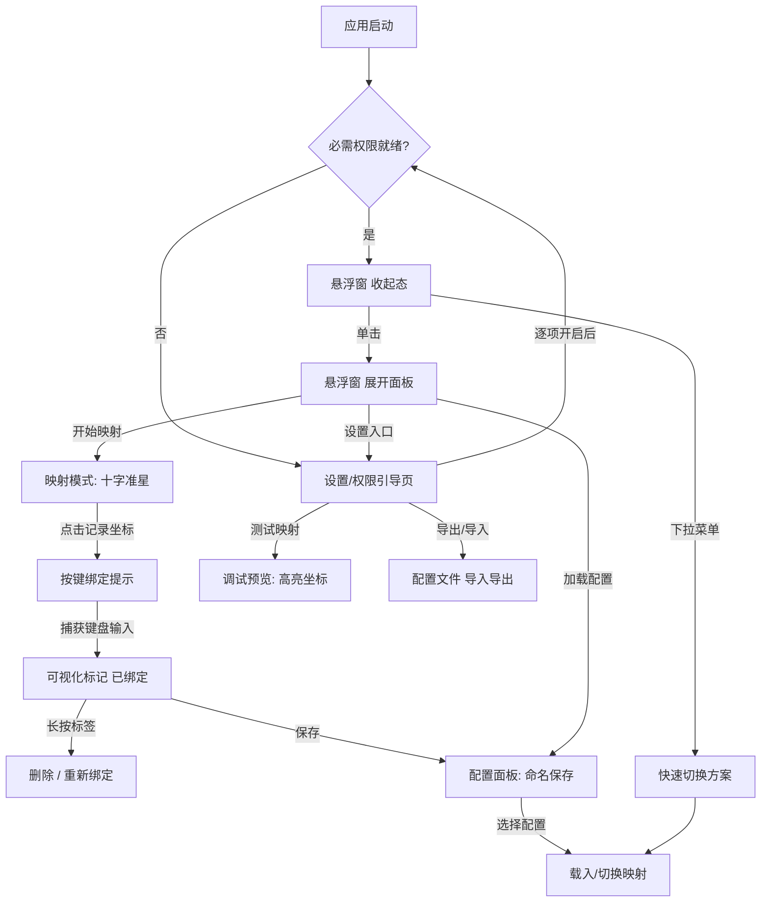

# 自定义屏幕按键映射工具 — 产品需求文档（PRD）

> 文档版本：v1.0 ｜ 角色：产品经理（许清楚）｜ 格式：简单 PRD（默认）

## 项目信息

| 项 | 内容 |
| --- | --- |
| Language | 简体中文 |
| Platform | Android 原生（Kotlin/Java，建议 minSdk 24+） |
| Project Name | `custom_screen_keymapper` |
| 文档范围 | 需求定义，不含架构与代码实现 |

**原始需求复述**：开发一款 Android 原生「自定义屏幕按键映射工具」，将物理键盘按键映射到屏幕坐标/手势，实现用键盘操控触屏游戏或应用。核心流程为：悬浮窗入口 → 进入映射模式（半透明十字准星记录坐标）→ 按键绑定（监听下一次键盘输入）→ 可视化标记（按键标签，长按删除/重绑）→ 配置管理（保存/加载/切换/删除命名配置）。技术要点：基于 `AccessibilityService` 获取点击坐标并后台监听全局键盘事件；映射数据以 JSON 存储（配置文件名、屏幕坐标、键值、标签颜色等）；悬浮窗使用 `TYPE_APPLICATION_OVERLAY` 跨应用显示。另含多模式切换、按键组合与宏指令、坐标分辨率适配、触控手势扩展、调试预览与导入导出、性能与权限优化等扩展能力。

---

## 一、产品目标

本产品面向需要在 Android 触屏设备（尤其是触屏游戏、掌机、平板）上使用物理键盘/鼠标进行操控的用户。通过"悬浮窗 + 映射模式 + 键盘监听"的轻量交互，用户可把任意键盘按键"落"到屏幕任意坐标，并以命名配置文件沉淀多套映射方案，从而用键鼠替代手指触控，获得更精准、更低疲劳的操作体验。

产品的核心价值在于**零侵入、可复用、易切换**：不修改目标应用本身，仅在本机叠加一层可视化映射层；映射结果以 JSON 配置文件形式持久化与迁移；为多款游戏/应用分别保存独立方案并可一键切换。MVP 阶段须保证"悬浮窗—映射—绑定—保存—加载"闭环稳定可用，扩展能力（组合键、宏、手势、适配、导入导出）作为差异化增强逐步交付。

---

## 二、用户故事

1. 作为**触屏游戏玩家**，我希望把常用技能键映射到物理键盘按键，以便用键盘替代屏幕点击，操作更快更稳。
2. 作为**多游戏用户**，我希望为每款游戏保存独立映射配置并能快速切换，以便不同游戏间无需重复设置坐标。
3. 作为**新手用户**，我希望首次启动时引导开启无障碍、悬浮窗、键盘监听权限，以便无需自行排查"为什么没反应"。
4. 作为**高级用户**，我希望录制按键组合与宏指令（如"Ctrl+1"或"W→延时→点击"），以便实现一键连招/复合操作。
5. 作为**换机/迁移用户**，我希望导出与导入配置文件，以便在新设备上秒级恢复全部映射方案。
6. 作为**在弱电场景使用的用户**，我希望低电量时自动降低悬浮窗刷新率，以便延长续航且不影响基本映射。

---

## 三、需求池

> 优先级说明：**P0** 核心必需（MVP 必须交付）；**P1** 重要扩展（增强竞争力，建议首版即含）；**P2** 增强（后续迭代）。

### P0 — 核心必需

**P0-1　可拖拽悬浮窗入口**
- 描述：应用启动后在系统层（`TYPE_APPLICATION_OVERLAY`）显示一个小悬浮窗，可自由拖拽；点击展开"开始映射 / 加载配置"面板。跨应用常驻显示。
- 验收标准：
  - 启动后悬浮窗出现且可被手指/鼠标拖到屏幕任意位置；
  - 点击悬浮窗弹出操作面板（开始映射、加载配置入口）；
  - 切到其他应用后悬浮窗仍可见、可交互。

**P0-2　映射模式与十字准星**
- 描述：进入映射模式后，全屏叠加半透明十字准星，用户点击屏幕任意位置即记录该坐标，准备绑定按键。
- 验收标准：
  - 进入映射模式出现半透明十字准星且不影响对下层坐标的采集；
  - 点击一次记录一个坐标点并进入按键绑定流程；
  - 可连续记录多个坐标点（多次点击）或退出映射模式。

**P0-3　键盘按键绑定**
- 描述：记录坐标后提示"请按下要绑定的键盘按键"，监听下一次键盘输入并捕获键值（keyCode/字符）完成绑定。
- 验收标准：
  - 提示文案正确展示；
  - 捕获到下一次按键即完成绑定，并回显键值；
  - 支持普通单键；组合键/宏（P1）不在本项强制范围。

**P0-4　可视化标记与长按管理**
- 描述：在已映射的屏幕坐标处显示按键标签（含颜色），长按该标签可"删除"或"重新绑定"。
- 验收标准：
  - 每个映射点显示标签且可自定义标签颜色；
  - 长按弹出操作菜单（删除 / 重新绑定）；
  - 操作后映射数据与界面即时同步。

**P0-5　配置文件保存 / 加载 / 删除**
- 描述：将当前全部映射保存为"命名配置文件"，可随时加载、切换、删除。
- 验收标准：
  - 输入名称即可保存当前映射集为一份配置；
  - 配置列表可加载（覆盖当前映射）与删除；
  - 删除前二次确认，避免误删。

**P0-6　AccessibilityService 全局键盘监听**
- 描述：通过无障碍服务获取屏幕点击坐标，并在后台监听全局键盘事件（捕获按键用于绑定与触发）。
- 验收标准：
  - 无障碍服务开启后可在映射模式采集点击坐标；
  - 服务在后台持续监听键盘事件，绑定与触发均生效；
  - 服务被系统回收后能自动重启/恢复。

**P0-7　JSON 格式映射存储**
- 描述：映射数据以 JSON 存储，至少包含：配置文件名、屏幕坐标（x,y）、键值、标签颜色等字段。
- 验收标准：
  - 导出/保存的 JSON 含上述字段且可被程序解析；
  - 文件名、坐标、键值、颜色字段缺失时给出合理默认或报错；
  - 数据结构与 P1 的坐标分辨率、手势、宏字段保持向前兼容（预留字段）。

**P0-8　首次权限引导**
- 描述：首次启动引导用户依次开启无障碍服务、悬浮窗（`SYSTEM_ALERT_WINDOW`）、键盘监听等必要权限，并说明用途。
- 验收标准：
  - 未授权时启动即跳转/提示对应系统设置页；
  - 逐项引导，可查看"为什么需要该权限"；
  - 全部必需权限就绪后进入正常使用流程。

### P1 — 重要扩展

**P1-1　多模式配置切换**
- 描述：为不同游戏/应用保存独立映射方案；悬浮窗下拉菜单快速切换，切换时自动加载对应坐标与按键绑定。
- 验收标准：
  - 悬浮窗下拉可列出全部配置并一键切换；
  - 切换后当前映射即时替换为目标方案；
  - 不同方案的元数据独立、互不污染。

**P1-2　按键组合绑定**
- 描述：支持绑定"按键组合"（如 `Ctrl+1`）触发同一位置点击。
- 验收标准：
  - 可录入组合键并绑定到坐标；
  - 同时按下组合键时正确触发，误触单键不触发；
  - 组合键显示格式清晰（如 "Ctrl+1"）。

**P1-3　宏指令录制**
- 描述：支持录制宏指令序列（如"按下 W → 延迟 500ms → 点击屏幕 → 松开 W"），绑定到按键后一键回放。
- 验收标准：
  - 提供录制入口，可记录按键、时序（延时）、屏幕点击；
  - 回放按录制顺序与延时执行；
  - 宏可命名、保存、绑定、删除。

**P1-4　坐标分辨率适配**
- 描述：保存映射时记录屏幕分辨率；加载时按当前分辨率自动缩放坐标，保证换屏/换设备后位置正确。
- 验收标准：
  - 保存的 JSON 含源分辨率字段；
  - 加载时按当前分辨率等比缩放坐标；
  - 同分辨率加载时坐标无偏移。

**P1-5　调试与预览高亮**
- 描述：提供"测试映射"按钮，按下键盘按键时在屏幕上高亮显示对应坐标，便于验证。
- 验收标准：
  - 进入测试模式后按任意绑定键，对应坐标高亮；
  - 高亮位置与实际触发坐标一致；
  - 退出测试模式恢复普通映射状态。

**P1-6　配置导出 / 导入**
- 描述：支持将配置文件导出到外部存储/分享，以及从文件导入恢复映射方案。
- 验收标准：
  - 导出生成可分享的 JSON 文件；
  - 导入可解析并重建配置（含分辨率、手势、宏等兼容字段）；
  - 导入冲突（同名配置）有覆盖/重命名提示。

### P2 — 增强

**P2-1　触控手势扩展**
- 描述：除普通点击外，支持映射为"长按""滑动""双指缩放"等手势。
- 验收标准：
  - 可为映射点选择触发类型（点击/长按/滑动/双指缩放）；
  - 触发对应手势效果与实际触控一致；
  - 不同手势在标记上有可区分标识。

**P2-2　鼠标滚轮映射**
- 描述：将"鼠标滚轮"映射为"屏幕上滑 / 下滑"等动作（需设备支持鼠标输入）。
- 验收标准：
  - 滚轮上/下可分别绑定到不同动作；
  - 触发时产生对应滑动效果；
  - 无鼠标的设备该能力可优雅隐藏/禁用。

**P2-3　低电量降频**
- 描述：低电量模式下自动降低悬浮窗刷新率/动画频率，平衡续航与可用性。
- 验收标准：
  - 电量低于阈值时自动切换为低刷新模式；
  - 映射触发精度不受影响；
  - 电量恢复后自动回到正常模式（可手动覆盖）。

---

## 四、UI 设计稿

### 4.1 关键界面（文本 / ASCII 示意）

**① 悬浮窗（收起态 / 展开态）**
```
收起态（可拖拽小球）：
        ┌────┐
        │ 🎮 │   ← 长按拖拽，单击展开
        └────┘

展开态（操作面板）：
  ┌────────────────┐
  │  KeyMapper   ✕  │
  ├────────────────┤
  │ [ 开始映射 ]    │
  │ [ 加载配置 ▾ ]   │
  │ [ ⚙ 设置 ]      │
  └────────────────┘
```

**② 映射模式（半透明十字准星）**
```
  ┌──────────────────────────┐
  │   （半透明遮罩 + 十字准星）  │
  │            │             │
  │            ├── 点击记录坐标 │
  │            │             │
  │   提示：点击屏幕记录坐标     │
  │   再按键盘完成绑定           │
  └──────────────────────────┘
```

**③ 按键绑定提示**
```
  ┌──────────────────────────┐
  │  已记录坐标 (x:540,y:960)  │
  │  ─────────────────────    │
  │  请按下要绑定的键盘按键…     │
  │  ▣ 等待输入…               │
  └──────────────────────────┘
```

**④ 配置面板（管理 / 切换）**
```
  ┌──────────────────────────┐
  │  我的配置        [+ 新建]   │
  ├──────────────────────────┤
  │ ◉ 王者荣耀方案    [载入][✕]│
  │ ○ 和平精英方案    [载入][✕]│
  │ ○ 原神方案       [载入][✕]│
  ├──────────────────────────┤
  │ [导出] [导入] [测试映射]    │
  └──────────────────────────┘
```

**⑤ 悬浮窗下拉切换菜单**
```
  ┌──────────────────┐
  │ ▾ 快速切换方案     │
  ├──────────────────┤
  │ ● 王者荣耀方案     │
  │ ○ 和平精英方案     │
  │ ○ 原神方案        │
  └──────────────────┘
```

**⑥ 设置 / 权限引导页**
```
  ┌──────────────────────────┐
  │  设置 / 权限引导          │
  ├──────────────────────────┤
  │ ✅ 无障碍服务             │
  │ ⚠ 悬浮窗权限  [去开启]    │
  │ ⚠ 键盘监听     [去开启]    │
  ├──────────────────────────┤
  │ 低电量降频： [开/关]       │
  │ 关于 / 导出导入            │
  └──────────────────────────┘
```

### 4.2 主要界面跳转关系（Mermaid flowchart）



---

## 五、待确认问题（需用户 / 架构师澄清）

1. **全局键盘事件来源与兜底**：`AccessibilityService` 在无障碍服务被系统回收或某些 ROM 限制时可能丢失键盘事件——除无障碍服务外，是否还需要前台 `ForegroundService` 或屏幕键盘（InputMethod）方案兜底？各方案对组合键/宏时序精度的影响如何？
2. **宏指令最小时间精度**：宏录制与回放的延时精度要求是多少（如 10ms / 50ms / 100ms）？是否需要支持"按住时长""重复次数"等更细粒度参数？
3. **双指缩放等复杂手势触发**：在仅用物理键盘/鼠标的场景下，"双指缩放""滑动"等手势如何被触发与模拟？是否需要依赖鼠标（如滚轮/右键拖拽）或虚拟辅助键？
4. **坐标采集的权威来源**：跨应用点击坐标以 `AccessibilityService` 的 `onAccessibilityEvent` 还是悬浮窗自身的 `MotionEvent`/`View` 坐标为准？如何处理导航栏/状态栏/刘海屏造成的坐标偏移与不同 DPI 下的换算？
5. **多配置方案的作用域判定**：悬浮窗下拉"快速切换方案"是依赖用户手动选择，还是需要按"当前前台应用包名"自动匹配并切换对应方案（需前台应用检测权限/能力）？
